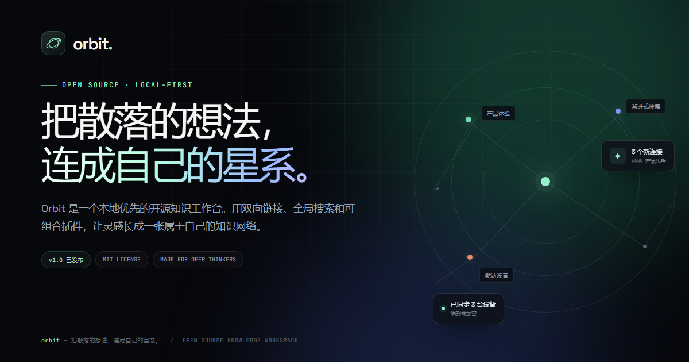

# Orbit

一个为开源项目打造的单页介绍站点：本地优先的知识工作台 Orbit。深色渐变、产品界面模拟、滚动入场动画、响应式布局，纯 HTML / CSS / JavaScript，无需构建。



## 在线访问

- 站点：https://kanebowman.github.io/orbit/
- 仓库：https://github.com/KaneBowman/orbit

## 页面内容

- 首屏产品展示与模拟知识库界面
- 6 项核心特性 Bento 卡片
- 三步工作流展示
- 开发者终端与插件 API 介绍
- 公开路线图
- GitHub / 开源 CTA 与页脚

## 本地预览

```bash
python -m http.server 8800
```

打开 http://127.0.0.1:8800/

## 技术说明

- 纯静态，无框架、无构建步骤
- 自托管 Space Grotesk / JetBrains Mono 字体
- 原生 IntersectionObserver 滚动动画，支持 `prefers-reduced-motion`
- 移动端菜单、复制安装命令、键盘可访问的跳转链接
- 相对路径资源，可直接部署在 GitHub Pages 子路径下

## 目录结构

```text
.
├── index.html
├── 404.html
├── assets/
│   ├── css/style.css
│   ├── js/main.js
│   ├── fonts/
│   └── img/
├── .nojekyll
├── LICENSE
└── README.md
```

## 部署

仓库已配置为从 `main` 分支根目录发布 GitHub Pages。后续更新只需推送新的提交，Pages 会自动重新构建。

## License

MIT © 2026 Orbit Contributors
